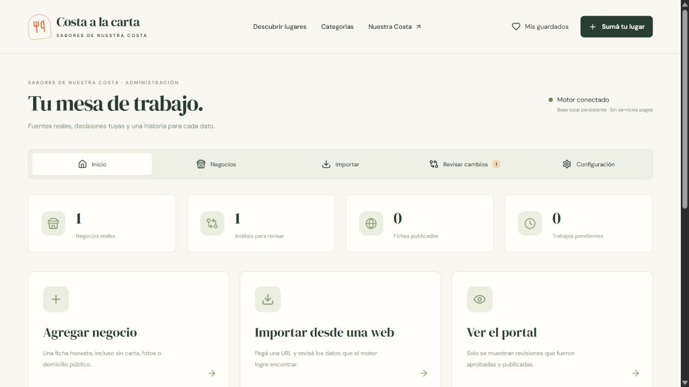

# Empezar con Costa a la carta

Esta es la versión nueva e independiente, en desarrollo local. Conserva el diseño original y agrega una base persistente y un motor real de evaluación. Todo el recorrido del administrador está en español.

**No es todavía un importador universal terminado.** Solo están habilitadas las fuentes de evaluación indicadas en Importar. OCR de fotografías ya está disponible en el navegador. PDF y páginas que necesitan ejecutar JavaScript siguen deshabilitados. No se instala WSL ni Linux.

## Abrir el sistema

1. En esta carpeta, abrí con doble clic **Costa a la carta - Motor.vbs**.
2. El lanzador intenta iniciar el sistema. Esperá «API local conectada».
3. Pulsá **Abrir administrador**. La dirección local es http://127.0.0.1:5174/administracion .
4. Si aparece el acceso, pulsá **Ingresar a la administración local**. Es una identidad de prueba de esta computadora.

Los requisitos están preparados en esta PC: Node 24, PowerShell 7 y dependencias del proyecto. La comprobación básica del lanzador pasó; falta que el dueño pruebe la ventana y sus botones. Si Windows impide ejecutarlo o aparece un error, no desactives sus protecciones: anotá el mensaje para resolverlo. No hace falta reinstalar dependencias en cada uso.

## Cargar un comercio

**Negocios → Agregar negocio** permite empezar sin importar una web. Completá nombre, localidad, categoría y referencia de qué verificaste. Dirección, carta, fotos y teléfono pueden quedar vacíos. No confirmes que un negocio está activo solo porque su página existe.

**Importar** permite pegar una web habilitada y explicar por qué se permite consultarla. Elegí una ficha existente si corresponde. Al terminar, abrí **Revisar**: cada dato es una propuesta; revisá localidad, sucursal, contactos y vigencia.

**Guardar borrador** conserva las correcciones sin publicar. **Proteger corrección** evita reemplazarla automáticamente con una observación nueva. En **Carta**, revisá cada producto, tamaño, precio, moneda y canal. Un `$` no confirma por sí solo pesos argentinos.

Cuando estés conforme, marcá la revisión editorial y usá **Guardar y aprobar revisión**. Después, **Solicitar publicación local**. Esperá la confirmación del motor. Una solicitud en cola todavía no está publicada.

## Leer una carta fotografiada

1. Elegí **Leer foto**. Podés usar una foto del dispositivo aunque el negocio no tenga web.
2. Indicá de dónde viene y confirmá que tenés una base legítima para analizarla. Esto no concede permiso para publicar la foto.
3. Seleccioná PNG, JPEG o WebP fijo (hasta 8 MB, 12 megapíxeles y 6000 px por lado). Pulsá **Analizar fotografía**. Podés cancelar y reintentar.
4. Corregí el texto reconocido si hace falta; el original se conserva por separado. Pulsá **Revisar platos y precios**.
5. En **Carta**, corregí producto, tamaño, precio y moneda. Comparalos con la foto, marcá la revisión de cada propuesta y elegí aprobar o descartar. El símbolo $ por sí solo no confirma ARS. Guardá el borrador para retomar después.
6. Completá los datos de **Ficha**, aprobá la revisión y solicitá publicación local por el recorrido habitual.

Para una foto detectada en una web: abrí la revisión del análisis → **Fotos** → elegí una de las imágenes. El motor debe estar conectado para descargarla; el reconocimiento sucede en tu navegador. Se muestran primero las probables cartas; también podés ver las demás y seleccionar manualmente. Otro dominio puede requerir confirmar antes su asociación en Fuentes.

La foto local no se sube al servidor para reconocerla. Las fotos de la web pasan temporalmente por el motor y se eliminan al consumirlas o vencer. El servidor conserva texto y procedencia. Ninguna se publica automáticamente. Para volver a reconocer una foto después de cerrar la pantalla, seleccioná de nuevo el original.

La lectura funciona mejor con texto claro. Las fotos reales con manuscritos, fondos o columnas probadas dieron resultados incompletos; no se consideran cartas transcritas con exactitud. Si no hay asociaciones legibles, el sistema lo informa. Una confianza alta tampoco sustituye tu revisión. Las partes dudosas se consultan junto al texto original y se pueden corregir o cargar manualmente. La precisión práctica con una foto del piloto y la prueba del dueño siguen pendientes.

## Fuentes, historial y copias

En una ficha, **Fuentes** permite vincular otra URL y configurar dominios relacionados; no necesita selectores ni programación. **Historial** conserva revisiones aprobadas y permite crear una nueva a partir de una anterior. No borra lo sucedido.

En **Configuración**, podés agregar categorías, provincias, partidos y localidades, vincular el motor y preparar copias. La copia diaria local quedó activada cuando el motor esté conectado. [Ver la guía de copias](docs/guia-copias.md).

La vinculación ya existe en esta PC. Si se revoca o hace falta renovarla, generá un código en Configuración y pegalo en el lanzador. Caduca en cinco minutos y se usa una vez. No compartas el código.

## Estado de los datos

Se conserva una ficha privada de La Gran Familia. También hay análisis de evaluación y lecturas OCR controladas, sin crear comercios de prueba en el portal. Su actividad actual no está confirmada y se retiró del portal; por eso hay cero publicaciones activas. Su lectura sirve como evidencia técnica, no como recomendación vigente del comercio.

Café San Bernardo se usó para comprobar una carta WordPress: está en CABA, no en La Costa. No se incorporó al piloto. Los veinte comercios de demostración siguen separados del catálogo real.

[Estado comprobado, pruebas y pendientes](docs/informes/estado-ocr-2026-10-22.md) · [Decisión vigente: OCR en navegador, sin WSL](docs/plan-aislamiento-local.md)