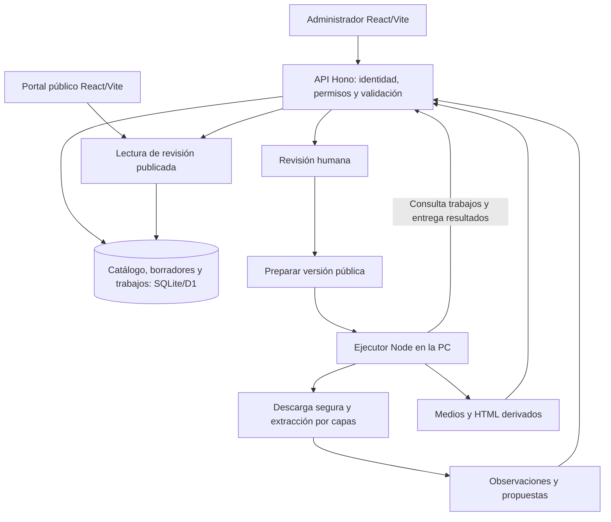

# Costa a la carta — Arquitectura y encargo de implementación

Fecha de referencia: 21/10/2026. Documento de propuesta; no autoriza despliegues, contrataciones ni migraciones externas. Supabase queda para una decisión posterior, según la última indicación del dueño.

## 1. Dictamen y evidencia

**El proyecto es aprovechable y puede evolucionar sin reconstruir la aplicación.** El cambio necesario es agregar capacidades de servidor, separar el acceso a datos de la interfaz e incorporar un motor con revisión editorial. Conectar una base por sí solo no implementa ese motor.

En esta revisión sí hubo acceso de lectura al repositorio `D:\Incoming\Videos\Proyectos\Gastronomia\costa-a-la-carta`. Se inspeccionaron el estado Git, dependencias, componentes principales de `App.jsx`, cliente opcional de Supabase, esquema preparado, entrada del cliente, entrada de render y prerender. Se ejecutó únicamente `node --test tests/directorio.test.mjs`: cinco pruebas aprobadas. No se ejecutó un nuevo build, no se hizo una auditoría integral ni una prueba visual o de extracción.

El diagnóstico entregado sobre `b1140c3` continúa siendo evidencia reportada. El estado observado ahora es distinto: HEAD `2bc13df`, con modificaciones locales en `package.json` y `package-lock.json`. Hay una línea base HTML y documentos de planificación anteriores. Las nuevas dependencias incluyen Hono, Drizzle, Zod y herramientas de Cloudflare; su presencia no demuestra un backend implementado. Todo ese trabajo debe preservarse y contrastarse antes de implementar.

El conector de Sites confirmó un sitio activo, versión 2, con acceso `custom`, en la URL conocida. Esto no permite afirmar que sea público ni que equivalga al HEAD local. `.openai/hosting.json` declara el proyecto y `dist`, pero no demuestra la política de acceso del alojamiento.

| Componente | Dictamen |
|---|---|
| Identidad, CSS, tarjetas, portada y navegación | Conservar. Refactorizar solamente lo necesario para integrar datos reales. |
| Búsqueda, categorías, filtros y rutas | Reutilizar; quitar del catálogo real filtros y ordenamientos que dependan de valoraciones ficticias. |
| Favoritos | Conservar localmente como preferencia del visitante; no confundirlos con persistencia editorial. |
| Ficha individual | Ampliar con cartas, variantes, fechas, fuentes públicas pertinentes y datos opcionales. |
| Alta, reclamo y panel del propietario | Conservar los recorridos; reemplazar permisos demostrativos por autorización real antes de habilitarlos. |
| Administración | Reutilizar componentes visuales; agregar importación, revisión, cartas, medios y fuentes. |
| Persistencia local del catálogo | Sustituir por repositorio a través de API. Separar estrictamente la demostración ficticia. |
| SQL preparado | Referencia conceptual; no ejecutarlo ni suponerlo compatible con SQLite/D1. Supabase queda pendiente. |
| Prerender | Reutilizar el enfoque y componentes; generar desde revisiones aprobadas, no desde `datos.js`. |
| Motor, procedencia, deduplicación y sincronización | Falta desarrollar e integrar. |

Se observaron fallbacks de imágenes ilustrativas en fichas nuevas y galería, y campos visuales de valoración/rango económico vinculados a la demo. Deben reemplazarse por estados honestos: sin foto, dato desconocido o sección oculta. Los precios de platos serán una entidad distinta de `$ / $$ / $$$`.

Los riesgos principales son atribuir información a una sucursal equivocada, relacionar mal una variante con su precio, perder correcciones, publicar material sin derechos, habilitar un importador que alcance la red privada y presentar como gratuito un diseño que depende de servicios facturables.

## 2. Arquitectura principal

Un **monolito modular con un ejecutor de tareas**, en el repositorio existente. El ejecutor se separa por necesidades de CPU y aislamiento; no se convierte en una colección de microservicios.

### Decisiones concretas

| Capa | Elección |
|---|---|
| Interfaz | React/Vite y CSS actuales. TypeScript en módulos nuevos y contratos; conversión gradual del código existente. |
| API | Hono, Zod y contratos versionados. Misma lógica de aplicación en desarrollo y nube. |
| Datos locales | D1 emulado persistente mediante Wrangler, basado en SQLite, dentro del proyecto. Sin llamadas a bases externas. |
| Datos online propuestos | D1 dedicado cuando se autorice la infraestructura. Drizzle para esquema/migraciones y repositorios explícitos. |
| Ejecutor | Node LTS compatible, proceso local separado. HTML/JSON/XML, Playwright aislado, PDF.js, Tesseract y optimización de imágenes. |
| Trabajos | Tabla persistente con lease, checkpoints y reintentos. Un ejecutor y una tarea pesada simultánea inicialmente. |
| Medios | KV dedicado para el piloto, con objetos pequeños e inmutables; índice y permisos en D1. R2 queda como evolución autorizada. |
| Identidad online | Google OIDC mediante biblioteca mantenida; identidad estable por `issuer + subject`, sesiones propias revocables y roles en la base. |
| Publicación online propuesta | Assets y API en Cloudflare Workers Free; HTML de contenido generado antes de publicar. La migración de alojamiento necesita autorización. |
| IA | Ninguna API generativa necesaria para el circuito base. Interfaz opcional, deshabilitada por defecto. |
| Mapas | Dirección verificada y enlace «Cómo llegar». Mapa interactivo y geocodificación no son dependencias del piloto. |

La decisión sobre Supabase queda fuera de este encargo inmediato. No se consultan ni modifican sus proyectos. Si más adelante se elige PostgreSQL/Supabase, se migran repositorios y datos con un procedimiento explícito: no es un cambio automático de URL de conexión.

**Por qué no Next.js:** no resuelve por sí mismo extracción, OCR, procedencia o permisos; agrega una migración de frontend sin beneficio suficiente para este piloto.

**Por qué no todo dentro de un Worker gratuito:** 10 ms de CPU por solicitud es un presupuesto para endpoints pequeños, no una garantía suficiente para OCR, un navegador o parsers grandes. Se medirán también autenticación, validaciones y publicación; el ejecutor no elimina ese control. [Límites oficiales de Workers](https://developers.cloudflare.com/workers/platform/limits/).

**Por qué no procesamiento dependiente de una pestaña abierta:** perder el navegador, suspender el celular o cerrar el panel no debe destruir una importación. El trabajo vive en la base y el ejecutor lo recupera.

**Por qué KV para el piloto:** permite guardar un volumen pequeño sin depender inicialmente de un servicio de almacenamiento con excedentes facturables. Es una concesión limitada, no la solución definitiva para una biblioteca de archivos. No contendrá roles, sesiones, locks ni el estado autoritativo de publicación. Su consistencia es eventual; una lectura global inmediata después de escribir no está garantizada. [Consistencia de KV](https://developers.cloudflare.com/kv/concepts/how-kv-works/).

**Sites no se descarta por ser necesariamente estático:** las guías instaladas documentan ejecución Worker, D1, R2 e identidad. La publicación actual es estática. No se verificó aquí una garantía contractual de cuotas/costos para ejecutar toda la nueva arquitectura allí. Por eso la referencia presupuestaria utiliza Workers propio; mantener la URL de Sites mediante su runtime requerirá una decisión de alojamiento y una comprobación específica. Conservar aplicación y rutas no garantiza conservar el hostname al migrar. No cambiarlo silenciosamente.

### Uso sin terminal y PC apagada

El programador entrega un lanzador «Costa a la carta — Motor», con runtime y dependencias resueltos, estado visible, reconexión y cierre sencillo. Doble clic; inicio al entrar a Windows solo si el dueño lo acepta. No exigir `npm`, Docker ni comandos para la operación cotidiana.

El ejecutor se vincula una vez mediante código breve, revocable y con vencimiento. Consulta la API por HTTPS saliente; no abre la PC a Internet, no usa túneles y no recibe credenciales generales de la nube. El analizador no hereda el token del ejecutor.

Con la PC apagada:

- El portal sirve la última revisión publicada y sus archivos ya alojados.
- El administrador online permite consultar, corregir y guardar borradores.
- Las extracciones, OCR y generación de una nueva publicación esperan al ejecutor.
- La interfaz muestra «Esperando que se conecte tu motor»; no muestra un éxito ficticio.
- Al reabrirlo continúa desde el último checkpoint confirmado.

Esta dependencia de procesamiento es el compromiso para empezar sin un servidor pago. Si se necesita importar y publicar con la PC apagada, habrá que alojar el mismo ejecutor en una infraestructura adecuada y evaluar su costo. La interfaz y el catálogo no cambian.

### Presupuesto y límites de diseño

Los límites fueron consultados el 21/10/2026; deben volver a comprobarse al habilitar una cuenta concreta. No se creó ningún servicio ni se comprobó la capacidad disponible de una cuenta de Cloudflare.

| Recurso Free | Límite documentado relevante | Decisión del piloto |
|---|---|---|
| Workers | 100.000 solicitudes/día, 10 ms CPU/solicitud, 128 MB | Endpoints pequeños; sin OCR ni Chromium. [Fuente](https://developers.cloudflare.com/workers/platform/limits/). |
| D1 | 5 millones de filas leídas y 100.000 escritas/día | Índices, paginación y operaciones acotadas. [Fuente](https://developers.cloudflare.com/d1/platform/pricing/). |
| D1 tamaño | 500 MB por base Free; 5 GB por cuenta; recuperación temporal de 7 días | Una base dedicada y respaldo adicional probado. [Fuente](https://developers.cloudflare.com/d1/platform/limits/). |
| KV | 1 GB, 100.000 lecturas y 1.000 escrituras/día | Presupuesto interno inicial de 300 MB y 200 escrituras/día, compartido con otros usos de cuenta si los hubiera. [Fuente](https://developers.cloudflare.com/kv/platform/pricing/). |
| KV tamaño | Hasta 25 MiB por valor | Tope propio: documentos 10 MB; derivados de imagen mucho menores. [Fuente](https://developers.cloudflare.com/kv/platform/limits/). |

Ejemplo de planificación, no medición: 20 comercios × 5 fotos × 250 KB son aproximadamente 25 MB. Originales, miniaturas, PDF y versiones se cuentan aparte. Los límites de la cuenta incluyen sus otros usos; el presupuesto de esta app no representa toda la cuenta. Los planes Free pueden detener operaciones al agotarse; no son una garantía de disponibilidad permanente. Alertas internas al 70% y detención de ingestas al 85% del presupuesto propio, sin ascender planes automáticamente.

R2 tiene una franquicia gratuita pero también cobro por excedentes: no se lo considera un tope de gasto cero. No se habilita en este piloto por rutina. [Precios de R2](https://developers.cloudflare.com/r2/pricing/).

## 3. Modelo único de datos

El modelo conserva una sola identidad de establecimiento, `listings.id`. Observaciones, versiones y proyecciones públicas no son catálogos alternativos: siempre referencian esa identidad.

| Conjunto | Entidades y reglas |
|---|---|
| Territorio | `provinces`, `districts`, `locations` con IDs y relaciones; alias «San Bernardo» / «San Bernardo del Tuyú». |
| Establecimientos | `listings`, `listing_aliases`, `slug_redirects`, `categories`, `listing_categories`, servicios, contactos, direcciones públicas opcionales y zona de atención. Sucursal = ficha independiente. |
| Horarios | Intervalos semanales, zona horaria, fin al día siguiente, vigencia estacional y excepciones. No inferir cierre por una web caída. |
| Fuentes | `sources`, `listing_sources`, `source_resources`, políticas de acceso, método permitido, procedencia, hash y fechas. Una web corporativa puede alimentar varias sucursales. |
| Importaciones | `import_jobs`, `import_runs`, `job_checkpoints`; un intento tiene versión de extractor y recursos realmente procesados. |
| Evidencia | `observations`: entidad/campo, valor bruto y normalizado, fuente, URL/archivo, selector o página/coordenadas, método, incertidumbre y fechas. Inmutables. |
| Selección editorial | `field_selections`: observación elegida, autor, fecha, motivo y protección manual. Lo manual también tiene procedencia. |
| Cartas | `menus`, `menu_versions`, `menu_sections`, `products`, `product_variants`, `price_offers`, y entradas de versión que congelan exactamente lo publicado. |
| Revisión | `change_sets`, `change_items`, `duplicate_candidates`, decisiones y `audit_events`. |
| Medios | `media_assets`, derivados, `media_rights` y vinculaciones a ficha/plato/carta; estado de derechos separado del estado de descarga. |
| Publicación | `listing_revisions`, `publication_jobs`, `publication_artifacts`, puntero a revisión visible y manifiesto de archivos. |
| Personas | `users`, `auth_identities`, `sessions`, `listing_memberships`, `listing_claims`, sugerencias; conservar el concepto de `owners`, `leads` y `reviews` con activación controlada. |

Los importes se guardan en unidad menor entera, moneda ISO, texto original, canal y condiciones. `null` significa precio desconocido; cero solo con evidencia explícita. No adivinar ARS únicamente porque aparece `$`. Una variante sin tamaño sigue existiendo como variante base; tamaño, cantidad y modalidad no se mezclan. Una carta histórica nunca se actualiza en lugar: se crea otra versión.

La comparación de actualización usa tres valores: última observación de esa fuente, dato editorial vigente y nueva observación. Ausencia no es eliminación. Los cambios protegidos generan conflicto visible. Las decisiones se aplican con control de versión para impedir que dos sesiones se pisen. La reversión crea una nueva revisión auditada.

## 4. Motor extensible

Cada importación sigue: validar acceso → descubrir → descargar → extraer → normalizar → proponer coincidencias → revisar → preparar publicación. El motor no publica por sí mismo.

Orden de estrategias: JSON-LD/Schema.org y metadatos; HTML semántico; enlaces internos; API pública permitida de CMS; sitemap/RSS/Atom/JSON/XML; adaptador de familia; navegador aislado cuando el contenido dependa de JavaScript; PDF textual; OCR local. La IA es opcional para ambigüedades y siempre conserva evidencia.

Un adaptador declara `id`, versión, capacidades, detección, descubrimiento y extracción. Solo usa servicios seguros del núcleo y devuelve el mismo contrato. No escribe directamente en el catálogo, no realiza fetch arbitrario ni contiene privilegios de publicación. Se implementan adaptadores por estructura reutilizable, no uno obligatorio por restaurante.

Límites iniciales: 8 páginas HTML, profundidad 2, 5 redirecciones, 2 MB descomprimidos por HTML, PDF hasta 10 MB/20 páginas, 40 MB por importación y una descarga por dominio cada 2 segundos. Los documentos grandes se procesan por lotes con checkpoint; máximo 10 minutos por trabajo antes de ofrecer continuación. Son políticas del producto, ajustables por medición; no cuotas de proveedor.

La seguridad de red cubre resolución DNS y conexión efectiva, IPv4/IPv6, redirecciones y subrecursos. Validar solo la URL inicial no alcanza. No hay proxy público abierto. Chromium se ejecuta sin sesiones personales, sin secretos y con aislamiento real y salida de red controlada; la interceptación de Playwright sola no constituye una garantía de aislamiento. [OWASP SSRF](https://cheatsheetseries.owasp.org/cheatsheets/Server_Side_Request_Forgery_Prevention_Cheat_Sheet.html), [red de Playwright](https://playwright.dev/docs/network).

Para PDF se extraen texto y posiciones; para escaneos, OCR con cajas de texto y marcas de ambigüedad. No convertir reconocimiento de caracteres en una certeza inventada sobre qué precio corresponde a cada plato. [PDF.js](https://mozilla.github.io/pdf.js/examples/), [Tesseract](https://tesseract-ocr.github.io/tessdoc/).

Instagram y Facebook tienen recorridos de fuente/enlace, referencia manual y carga autorizada. No se promete extracción general ni se eluden controles. Encontrar una foto no concede permiso para republicarla.

## 5. Administrador

Navegación principal: **Inicio · Negocios · Importar · Revisar cambios · Configuración**. Dentro de cada negocio: **Ficha · Carta · Fotos · Fuentes · Historial**. Titularidades y sugerencias se agrupan en pendientes; no hace falta multiplicar pantallas.

**Importar:** pegar URL → Analizar sitio → progreso por etapas reales → resumen de lo encontrado → elegir ficha nueva/existente → corregir → Guardar borrador o Publicar. Los contadores proceden del resultado guardado. Cada campo permite ver fuente, fecha y motivo de incertidumbre. Los datos ausentes quedan vacíos.

**Carta:** tabla visual por sección con producto, variante, canal, precio y moneda; original al lado con resaltado del fragmento. Aceptar, corregir, dividir, unir o descartar filas; atajos de teclado y versión móvil por tarjetas. Guardado persistente y recuperable.

**Revisar cambios:** mostrar «Publicado», «Encontrado ahora» y «Tu corrección protegida» cuando corresponda. Aprobar por campo o lote seguro; no preseleccionar conflictos, eliminaciones o cambios de derechos.

**Fotos:** distinguir «Encontrada», «Uso pendiente», «Autorizada», «Publicada». Fuente, permiso y atribución son visibles. Sin derechos confirmados, no aparece como foto del comercio.

**Errores:** «La web no respondió. Podés volver a intentar o completar los datos»; «Encontramos el plato, pero no pudimos asociarle un precio»; «El motor está desconectado; guardamos tu tarea». Detalles técnicos ocultos en un diagnóstico exportable sin secretos.

**Propietarios:** mantener alta y reclamo. Activar en el piloto solo acceso por invitación y propuestas revisadas, luego de verificar permisos. El dueño central aprueba titularidades; un propietario no publica directamente ni altera roles/destacados. Reseñas públicas y correos automáticos permanecen deshabilitados hasta contar con sus políticas y operación verificadas.

## 6. Hitos y auditorías proporcionadas

| Hito | Resultado funcional y prueba de salida |
|---|---|
| 1. Primer circuito real local | Una URL real permitida produce datos con evidencia; revisión, guardado persistente y ficha visible localmente. Incluye creación manual y reabrir la aplicación. No esperar a modularizar todo para demostrar extracción. |
| 2. Carta, medios y actualización | HTML gastronómico, PDF textual y fotografía; variantes/precios; segunda fuente; detectar cambio controlado; conservar corrección; reanudar tarea. Matriz de distintas estructuras. |
| 3. Demo online aislada | Tras permiso, persistencia entre dispositivos, autenticación, publicación coherente, cuotas medidas y portal accesible con PC apagada. Prueba de restauración completa. |
| 4. Piloto utilizable | 10–20 negocios reales de San Bernardo, incluidos casos incompletos; dueño opera sin comandos; permisos de propietarios invitados; evidencias A–R y limitaciones declaradas. |

**Auditoría 1:** al completar el camino de descargas y antes de habilitar JavaScript/documentos no confiables de manera general. Auditor de solo lectura inspecciona código y ejecuta pruebas de SSRF, redirecciones, DNS rebinding, aislamiento y archivos maliciosos. Sin hallazgos críticos/altos pendientes en esa superficie. Una prueba en fuente real inicial usa el descargador básico con controles ya verificados; no se exige una auditoría por cada restaurante.

**Auditoría 2:** antes de abrir la demo online y sus escrituras a otros usuarios. Identidad, IDOR, datos privados, publicación, recuperación, cuotas y aislamiento de proyectos. El auditor verifica código y evidencia reproducible. Para Claude Code, chat nuevo en la misma carpeta, sin modificar el código. Reauditoría focalizada tras correcciones.

La usabilidad se valida con el dueño y, si está disponible, otra persona no técnica: alta manual, importación, corrección de precio, segunda fuente y actualización protegida. Deben completar los recorridos sin terminal ni intervención del programador. Registrar tiempo, dudas, errores y si se necesitó ayuda; una prueba automática no reemplaza esta sesión.

No se declara un hito completo por tener tests verdes. Se informa separado: implementado, probado con fixtures, probado en sitios controlados, probado con fuentes reales, desplegado y observado por el usuario.

## 7. Evolución

Agregar localidades es incorporar registros y contenidos, no cambiar componentes. El mismo catálogo sirve para otros partidos. El primer crecimiento es mantener D1, ampliar presupuesto cuando se autorice, mover los objetos a R2 y ejecutar el mismo proceso Node en un servidor. PostgreSQL/Supabase sería otra decisión posterior, con migración explícita y validación de permisos.

El contrato entre interfaz, API y motor permanece. Nuevos adaptadores agregan capacidades sin alterar las pantallas. Exportar datos, evidencias permitidas, medios, derechos y versiones evita quedar atado al alojamiento.

El prompt autónomo y copiable de esta propuesta está en `costa-a-la-carta-prompt-maestro-revision-2026-10-21.md`. Los documentos anteriores se preservaron; esta propuesta no presupone aprobaciones mencionadas en ellos ni reanuda trabajos de implementación.
